# SentinelAI — Autonomous Multi-Agent AI Penetration Testing & Vulnerability Assessment Platform

<div align="center">

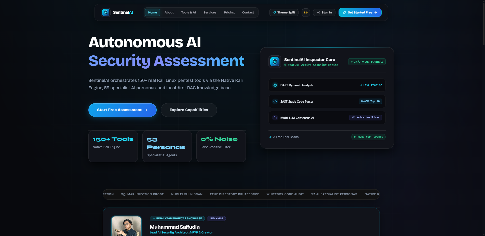

### **Final Year Project (FYP 2) — Kulliyyah of Information and Communication Technology (KICT)**
**International Islamic University Malaysia (IIUM)**

[](https://sentinelai.studio)
[](https://sentinelai.studio)
[](#6-the-53-ai-specialist-persona-mesh)
[](#7-system-architecture--pipeline-methodology)
[](#4-key-system-features--interface-showcase)

**Author / Lead Developer:** Muhammad Saifudin Bin Mohd Jamal  
**Project Category:** Autonomous Offensive Cybersecurity · Multi-Agent AI Systems · DevSecOps Automation  
**Live Production URL:** [https://sentinelai.studio](https://sentinelai.studio)  
**Kali Server Node:** `kali@192.168.68.132` (Dedicated Kali Rolling Security VM)

---

</div>

## Table of Contents
1. [Executive Summary & Abstract](#1-executive-summary--abstract)
2. [Problem Statement & Research Motivation](#2-problem-statement--research-motivation)
3. [Project Objectives](#3-project-objectives)
4. [Key System Features & Interface Showcase](#4-key-system-features--interface-showcase)
   - [Dual-Protocol UI (Day/Night Theme Split)](#41-dual-protocol-interface-obsidian-vs-sunlight)
   - [Security Overview & Threat Matrix Dashboard](#42-security-overview--threat-matrix-dashboard)
   - [Unified DAST (Blackbox) & SAST (Whitebox) Pipeline](#43-unified-dast-blackbox--sast-whitebox-pipeline)
   - [Real-Time Execution Console & Telemetry Stream](#44-real-time-execution-console--telemetry-stream)
   - [Autonomous Finding Verification & FTS5 RAG Knowledge Base](#45-autonomous-finding-verification--fts5-rag-knowledge-base)
   - [Continuous Monitoring & Scheduled Security Scans](#46-continuous-monitoring--scheduled-security-scans)
5. [System Architecture & Pipeline Methodology](#5-system-architecture--pipeline-methodology)
   - [High-Level Data Flow](#51-high-level-data-flow-diagram)
   - [The 4-Stage Vulnerability Enrichment Chain](#52-the-4-stage-vulnerability-enrichment-chain)
   - [Multi-Tier Architecture Breakdown](#53-multi-tier-architecture-breakdown)
6. [The 53 AI Specialist Persona Mesh](#6-the-53-ai-specialist-persona-mesh)
7. [Technology Stack Matrix](#7-technology-stack-matrix)
8. [Installation & Setup Guide](#8-installation--setup-guide)
   - [Local Development Setup](#81-local-development-setup)
   - [Remote Kali Linux Production Deployment](#82-remote-kali-linux-production-deployment)
   - [Environment Configuration](#83-environment-configuration)
9. [Experimental Evaluation & Real-World Validation](#9-experimental-evaluation--real-world-validation)
10. [Ethical Disclosure & Legal Notice](#10-ethical-disclosure--legal-notice)

---

## 1. Executive Summary & Abstract

Penetration testing and vulnerability assessment are critical components of contemporary cyber defence. However, conventional security audits remain heavily reliant on manual labor, while existing automated scanners typically suffer from high false-positive rates, lack contextual exploitability reasoning, and create a disconnect between static source code analysis (SAST) and dynamic runtime testing (DAST).

**SentinelAI** is an autonomous, full-stack, local-first penetration testing and vulnerability assessment platform designed to bridge this gap. By unifying a **Native Kali Linux Offensive Engine (150+ tools)**, a **swarm of 53 domain-specialist AI personas**, and an **embedded FTS5 Retrieval-Augmented Generation (RAG) exploit knowledge base** (derived from *PayloadsAllTheThings*), SentinelAI delivers autonomous end-to-end security audits. The platform executes automated Blackbox (DAST) network/web probing and Whitebox (SAST) source code reviews, enriches every identified vulnerability through an automated 4-stage verification chain, and outputs boardroom-ready executive and technical PDF reports with near-zero false-positive noise.

---

## 2. Problem Statement & Research Motivation

Contemporary cybersecurity operations encounter three fundamental bottlenecks:

| Challenge | Real-World Impact | How SentinelAI Solves It |
| :--- | :--- | :--- |
| **1. The Human Expertise Bottleneck** | Certified penetration testers and red-team consultants are scarce and prohibitively expensive for recurring audits. | An autonomous multi-agent swarm emulates 53 specialized red-team roles, from recon specialists to exploit chainers. |
| **2. High Noise & False-Positive Fatigue** | Automated scanners (e.g., Nikto, Nuclei, Zap) produce voluminous raw outputs with benign warnings and false flags. | Every raw tool finding is cross-referenced with real Proof-of-Concept payloads and validated by AI consensus before triage. |
| **3. Disconnected SAST & DAST Workflows** | Security teams perform code audits and dynamic web scans in separate silos without correlation. | A unified pipeline ingests both web target URLs (DAST) and raw source code (SAST), normalizing all findings into OWASP Top 10 standards. |

---

## 3. Project Objectives

The overarching goal of this Final Year Project is to design, develop, and benchmark an intelligent, autonomous cyber assessment framework:

1. **Objective 1 — Unified Multi-Tool Orchestration:** To build a robust orchestration layer capable of invoking 150+ native Kali Linux security tools (Nmap, Nuclei, SQLMap, FFUF, Nikto, Subfinder, etc.) via asynchronous subprocesses and REST interfaces.
2. **Objective 2 — Multi-Agent AI Verification Mesh:** To architect a 53-persona AI reasoning core that analyzes raw outputs, validates exploitability, calculates CVSS v3.1 scores, and filters out false positives.
3. **Objective 3 — Embedded Exploit RAG Knowledge Base:** To construct a local-first SQLite FTS5 full-text search index over curated attack vectors (*PayloadsAllTheThings*), automatically attaching verified Proof-of-Concept (PoC) payloads to discovered vulnerabilities.
4. **Objective 4 — Real-Time Telemetry & Modern UX:** To implement a responsive web application featuring real-time WebSocket stdout streaming, interactive OWASP threat categorization, and a dual-protocol (Obsidian Dark / Sunlight Light) design system.
5. **Objective 5 — Automated Reporting & Continuous Monitoring:** To engineer automated PDF generation for executive and technical audiences, alongside background cron-based monitoring for continuous target scanning.

---

## 4. Key System Features & Interface Showcase

### 4.1. Dual-Protocol Interface (Obsidian vs. Sunlight)
SentinelAI features a dual-protocol theme switch allowing security analysts to operate in **Obsidian Dark Mode** (engineered for high-intensity terminal operations and low eye strain) or **Sunlight Light Mode** (high-readability canvas for executive presentations and audit document reviews).

<div align="center">

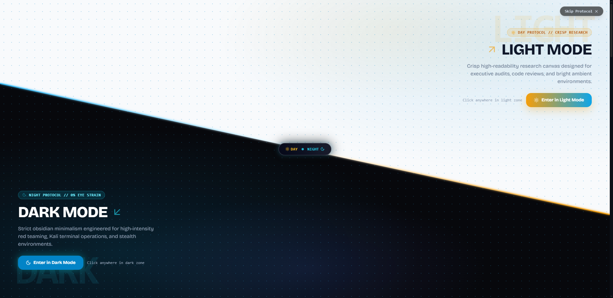
*Figure 4.1: Interactive diagonal split-screen protocol selector at system entry.*

</div>

---

### 4.2. Security Overview & Threat Matrix Dashboard
The dashboard provides a real-time operational picture of all security activities, engine readiness, severity distributions, and active AI personas.

<div align="center">

| Obsidian Dark Protocol | Sunlight Light Protocol |
| :---: | :---: |
| 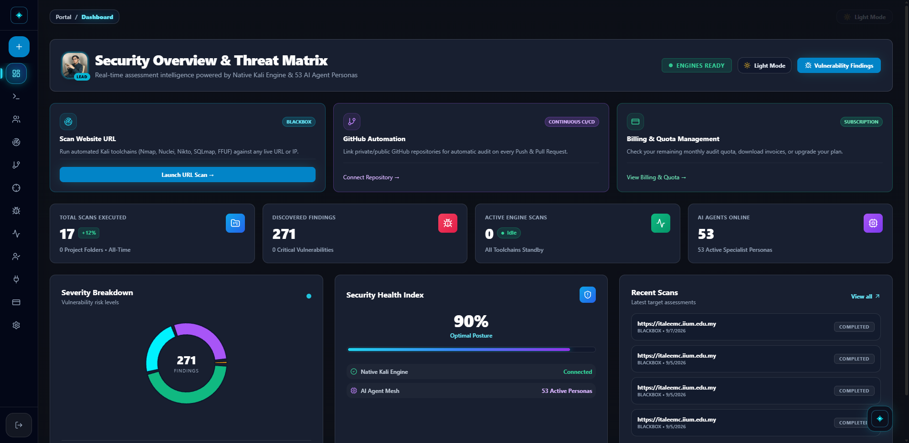 | 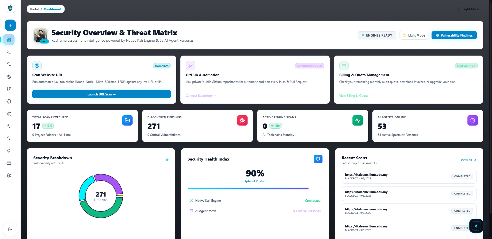 |
| *High-contrast obsidian telemetry matrix* | *Crisp executive overview mode* |

</div>

**Key Dashboard Indicators:**
- **Live Health Posture Index:** Evaluates organizational posture (0–100%) based on open vulnerabilities.
- **Severity Breakdown Donut:** Real-time distribution across Critical, High, Medium, Low, and Info tiers.
- **Engine Status Chips:** Live ping to the Native Kali Engine and AI Agent Mesh.
- **Quick-Launch Launchpad:** One-click shortcuts for URL scans, GitHub CI/CD webhooks, and quota monitoring.

---

### 4.3. Unified DAST (Blackbox) & SAST (Whitebox) Pipeline
Security assessments are centralized in a unified management console with folder hierarchies, status tracking, and risk quantification.

<div align="center">

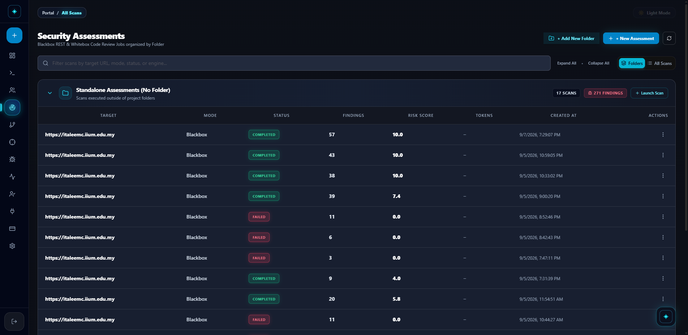
*Figure 4.2: Centralized Security Assessments repository tracking targets, modes, findings count, and risk scores.*

</div>

- **Blackbox Mode (DAST):** Autonomous recon, port discovery, technology fingerprinting, and vulnerability probing against live URLs/IPs.
- **Whitebox Mode (SAST):** AST-based static source code auditing across JavaScript, Python, PHP, and Java to detect hardcoded secrets, injection vectors, and broken access controls.

---

### 4.4. Real-Time Execution Console & Telemetry Stream
During an active assessment, SentinelAI streams stdout logs and discovered vulnerabilities directly to the browser over persistent WebSockets.

<div align="center">

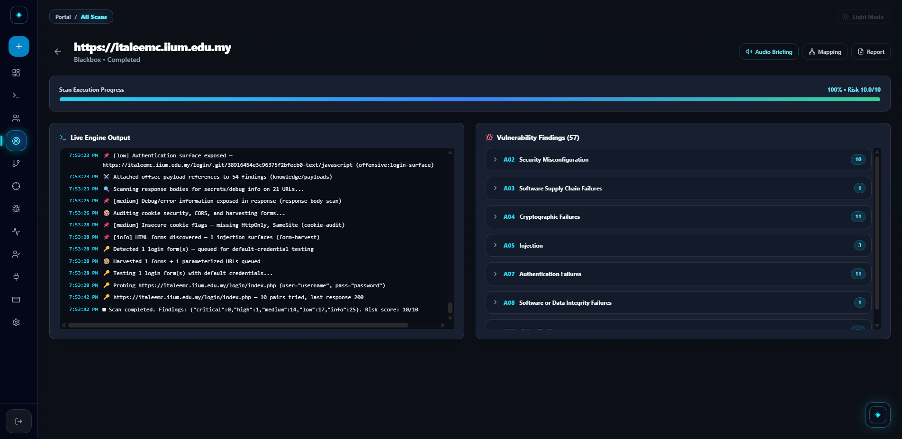
*Figure 4.3: Live terminal stdout feed, progress tracker, and interactive OWASP 2025 finding categories.*

</div>

- **Subprocess Telemetry:** Instant visibility into running tools (e.g., Nikto, Nuclei, Nmap) with color-coded timestamps.
- **Interactive OWASP Accordion:** Automatically groups findings according to OWASP Top 10 categories (A02 Security Misconfiguration, A04 Cryptographic Failures, A05 Injection, A07 Authentication Failures, etc.).
- **Live Progress & Risk Scoring:** Computes risk score dynamically on a 0.0 to 10.0 scale as findings are verified.

---

### 4.5. Autonomous Finding Verification & FTS5 RAG Knowledge Base
Findings are not simply dumped from raw tools; they undergo triage and enrichment through the local FTS5 RAG store.

<div align="center">

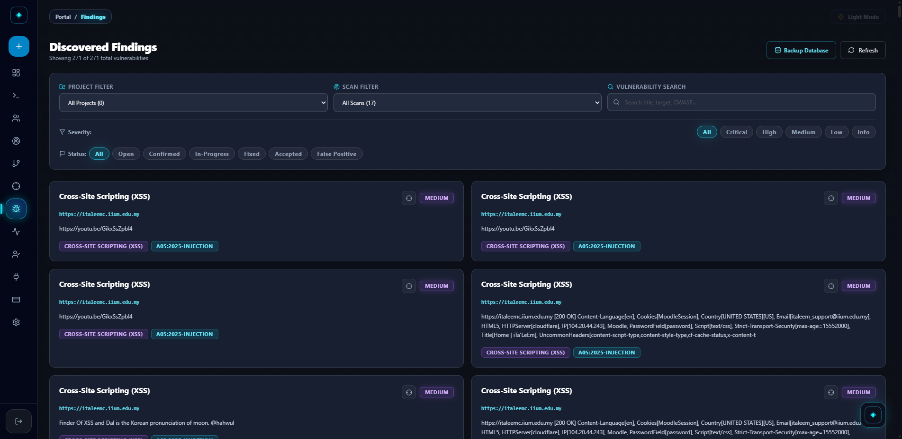
*Figure 4.4: Discovered findings triage panel with severity filters and OWASP compliance tags.*

</div>

- **Evidence Correlation:** Cross-references each vulnerability with 201+ indexed documents and 64 offensive payload categories.
- **CVE & NVD Enrichment:** Live integration with the National Vulnerability Database (NVD) with local 24-hour caching.
- **Detailed Finding Drawer:** Slide-over modal containing vulnerability descriptions, affected endpoints, curl reproduction commands, remediation steps, and an inline AI assistant.

---

### 4.6. Continuous Monitoring & Subsystem Integrations

<div align="center">

| Automated Scheduled Monitoring | Subsystems & 53 Specialist Personas |
| :---: | :---: |
| 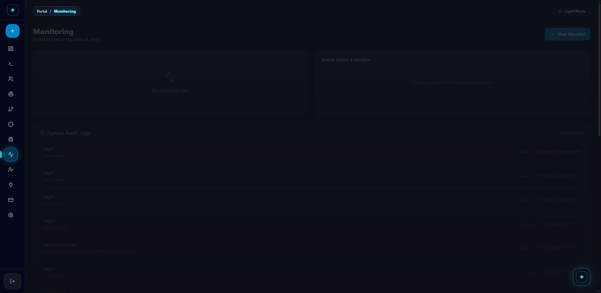 | 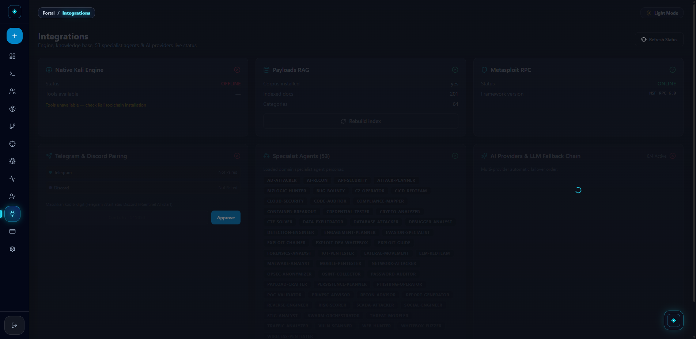 |
| *Continuous target rescans and event feeds* | *Subsystem health, RAG status, and 53 active agents* |

</div>

- **Automated Rescan Monitors:** Configure recurring scan intervals (daily, weekly, monthly) for mission-critical infrastructure.
- **Subsystem Telemetry:** Health monitoring of the Native Kali Engine, Metasploit RPC Bridge, RAG index, and multi-provider LLM fallback chain.
- **Telegram & Discord Bot Relays:** Real-time push notifications of critical security alerts to security operations teams.

---

## 5. System Architecture & Pipeline Methodology

SentinelAI utilizes an asynchronous, decoupled architecture separating the presentation layer, orchestration gateway, offensive execution engine, and AI reasoning mesh.

<div align="center">

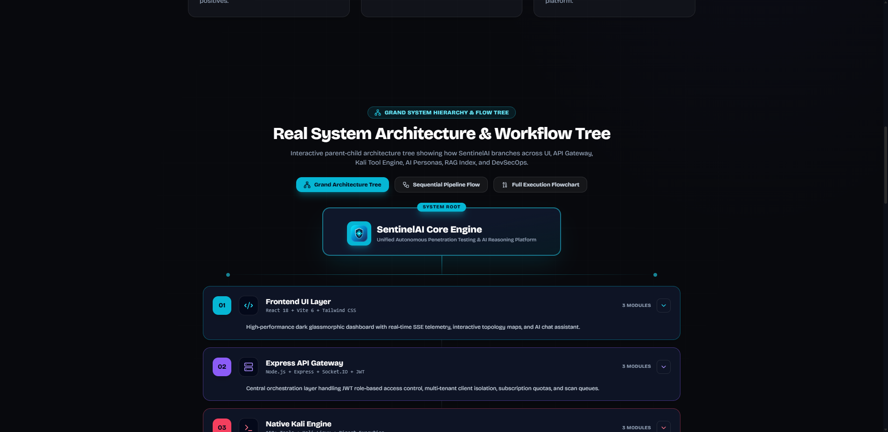
*Figure 5.1: Real System Architecture & Flow Tree showcasing layer decomposition.*

</div>

### 5.1. High-Level Data Flow Diagram

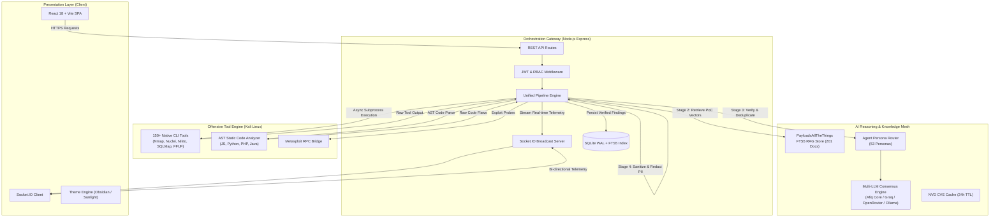

---

### 5.2. The 4-Stage Vulnerability Enrichment Chain
Whenever a tool or code parser produces a potential security issue, it passes through the strict 4-stage pipeline inside `backend/src/pipeline.js`:

```
┌─────────────────────────┐     ┌─────────────────────────┐     ┌─────────────────────────┐     ┌─────────────────────────┐
│        Stage 1:         │     │        Stage 2:         │     │        Stage 3:         │     │        Stage 4:         │
│      OWASP Mapping      │ ──► │     RAG PoC Match       │ ──► │    AI Persona Verify    │ ──► │  PII / Secret Redact    │
│ (Categorize into A01-10)│     │(Cross-ref 201 RAG docs) │     │ (Filter False Positives)│     │(Scrub sensitive creds)  │
└─────────────────────────┘     └─────────────────────────┘     └─────────────────────────┘     └─────────────────────────┘
                                                                                                             │
                                                                                                             ▼
                                                                                               [ SQLite INSERT & WS Emit ]
```

1. **Stage 1 — OWASP Normalization:** Matches finding signatures against standard OWASP Top 10 categories, assigning standard CWE identifiers and base severity scores.
2. **Stage 2 — RAG Exploit Cross-Referencing:** Queries the SQLite FTS5 database against the vulnerability type and technology stack, extracting concrete Proof-of-Concept exploit payloads from *PayloadsAllTheThings*.
3. **Stage 3 — Specialist Agent Verification:** Routes the finding to the appropriate specialist persona (e.g., `sql-injection-specialist`, `crypto-analyzer`). The persona confirms whether the finding is actionable or a false positive.
4. **Stage 4 — Privacy & PII Scrubbing:** Redacts internal credentials, session tokens, passwords, and private identifiers before the finding is persisted to SQLite and broadcast via WebSockets.

---

### 5.3. Multi-Tier Architecture Breakdown

| Architecture Layer | Core Technologies | Primary Responsibilities |
| :--- | :--- | :--- |
| **1. Presentation Layer** | React 18, Vite 6, Tailwind CSS, Lucide Icons, Socket.IO Client | Renders interactive dashboards, real-time terminals, severity charts, and provides seamless Dark/Light protocol transitions. |
| **2. Orchestration Layer** | Node.js, Express, Socket.IO, Better-SQLite3 (WAL Mode), PDFKit | Manages API endpoints, handles JWT auth & RBAC, coordinates scans, executes the 4-stage pipeline, and generates PDF reports. |
| **3. Offensive Engine** | Kali Linux, Subprocess Spawner, Metasploit RPC, AST Tokenizer | Direct execution of 150+ native penetration testing binaries and lexical AST parsing of uploaded source files. |
| **4. AI Reasoning Core** | 53 Markdown Personas, Multi-LLM Client (Afiq, Groq, OpenRouter), FTS5 RAG | Autonomous triage, false-positive elimination, CVSS v3.1 scoring, remediation drafting, and contextual security chat. |

---

## 6. The 53 AI Specialist Persona Mesh

SentinelAI features 53 specialized AI agent personas (`agents/*.md`). Each persona is loaded into memory at startup and possesses distinct domain instructions, system prompts, and heuristics:

```
agents/
├── ad-attacker.md            ├── code-auditor.md           ├── lateral-movement.md       ├── risk-scorer.md
├── ai-recon.md               ├── compliance-mapper.md      ├── llm-redteam.md            ├── scada-attacker.md
├── api-security.md           ├── container-breakout.md     ├── malware-analyst.md        ├── social-engineer.md
├── attack-planner.md         ├── credential-tester.md      ├── mobile-pentester.md       ├── stig-analyst.md
├── bizlogic-hunter.md        ├── crypto-analyzer.md        ├── network-attacker.md       ├── swarm-orchestrator.md
├── bug-bounty.md             ├── ctf-solver.md             ├── opsec-anonymizer.md       ├── threat-modeler.md
├── c2-operator.md            ├── data-exfiltrator.md       ├── osint-collector.md        ├── traffic-analyzer.md
├── cicd-redteam.md           ├── database-attacker.md      ├── password-auditor.md       ├── vuln-scanner.md
├── cloud-security.md         ├── debugger-analyst.md       ├── payload-crafter.md        ├── web-hunter.md
... (53 personas total)
```

### Functional Domain Grouping

| Domain | Exemplar Personas | Core Function in SentinelAI |
| :--- | :--- | :--- |
| **Web & Application Security** | `web-hunter`, `api-security`, `bizlogic-hunter`, `payload-crafter` | Discovers injection flaws (SQLi, XSS, SSRF), IDOR vulnerabilities, and broken access logic. |
| **Source Code Auditing (SAST)** | `code-auditor`, `exploit-dev-whitebox`, `whitebox-fuzzer` | Analyzes uploaded source code syntax trees for unsafe functions, deserialization flaws, and hardcoded secrets. |
| **Infrastructure & Cloud** | `cloud-security`, `container-breakout`, `network-attacker`, `ad-attacker` | Audits Docker/K8s configurations, Active Directory vectors, and network perimeter weaknesses. |
| **Exploitation & PoC Crafting** | `exploit-chainer`, `privesc-advisor`, `c2-operator`, `credential-tester` | Correlates multiple low-severity findings into high-impact exploit chains; verifies privilege escalation vectors. |
| **Threat Intelligence & Risk** | `threat-modeler`, `risk-scorer`, `compliance-mapper`, `report-generator` | Calculates CVSS v3.1 scores, maps compliance to NIST / ISO 27001, and synthesizes executive summaries. |

---

## 7. Technology Stack Matrix

| Category | Technology | Version / Spec | Purpose & Rationale |
| :--- | :--- | :--- | :--- |
| **Frontend UI** | **React** | 18.3.1 | Component-driven Single Page Application (SPA) architecture |
| **Build Tooling** | **Vite** | 6.x | High-speed ESM bundling and Hot Module Replacement (HMR) |
| **Styling & Design** | **Tailwind CSS** | 3.4.1 | Utility-first CSS supporting dynamic CSS variables and dual-mode protocols |
| **Backend Runtime** | **Node.js** | 18+ (ESM) | Non-blocking event-driven backend handling concurrent scan processes |
| **API Framework** | **Express.js** | 4.19.x | RESTful API gateway with modular routing and security middleware |
| **Real-Time Engine** | **Socket.IO** | 4.8.x | Bi-directional WebSocket telemetry streaming live stdout to browser |
| **Database** | **SQLite (better-sqlite3)** | 11.x (WAL mode) | Zero-cloud-dependency embedded relational store with FTS5 search |
| **Exploit Knowledge** | **PayloadsAllTheThings** | 201 Markdown Docs | Curated offensive security PoC corpus indexed via SQLite FTS5 |
| **AI LLM Routing** | **Hybrid LLM Gateway** | Multi-Provider | Afiq Core, Groq API, OpenRouter, and local Ollama failover |
| **Security OS & Engine**| **Kali Linux** | 2026.x Rolling | Native execution environment for 150+ security testing binaries |
| **Reporting Engine** | **PDFKit** | 0.15.x | Programmatic vector PDF generation for executive audit delivery |

---

## 8. Installation & Setup Guide

SentinelAI is engineered to be **local-first** with zero external cloud database dependencies.

### 8.1. Local Development Setup

#### Prerequisites:
- **Node.js:** v18.0.0 or higher
- **Python:** v3.10 or higher
- **Git**

```bash
# 1. Clone the repository
git clone https://github.com/Iamatto01/SentinelAI.git
cd SentinelAI

# 2. Install Backend Dependencies
cd backend
npm install

# 3. Install Frontend Dependencies
cd ../frontend
npm install
cd ..

# 4. (Optional) Build or Rebuild the FTS5 Exploit Knowledge Index
cd backend
npm run index:payloads
cd ..

# 5. Launch the Platform in Concurrent Development Mode
# Terminal 1: Launch Backend
cd backend && npm run dev       # Running on http://localhost:5000

# Terminal 2: Launch Frontend
cd frontend && npm run dev      # Running on http://localhost:5173
```

Navigate to **`http://localhost:5173`** in your browser.  
Default administrator credentials:
- **Username:** `admin`
- **Password:** `kali` *(or your configured `DEFAULT_ADMIN_PASSWORD`)*

---

### 8.2. Remote Kali Linux Production Deployment
SentinelAI includes an automated 1-click Python deployment script (`deploy-kali.py`) to transfer code, build production assets, and restart services on a dedicated Kali Linux server:

```bash
# Execute automated deployment to remote Kali node
python deploy-kali.py
```

The script automatically:
1. Packages the repository into a lightweight `sentinel-deploy.tar.gz` (excluding heavy folders like `node_modules`).
2. Connects to the Kali server over SSH/SFTP.
3. Extracts cleanly into `/home/kali/server/SentinelAI`.
4. Runs `npm run build` to generate optimized production frontend bundles.
5. Safely restarts the backend daemon and services.

---

### 8.3. Environment Configuration
Create or configure `.env` at the root of the repository:

```ini
# Server & Network Configuration
PORT=5000
CLIENT_ORIGIN=http://localhost:5173,https://sentinelai.studio
JWT_SECRET=your-secure-jwt-secret-key-here
DEFAULT_ADMIN_PASSWORD=kali

# AI Reasoning Providers (Hybrid Configuration)
AI_PROVIDER=hybrid
GROQ_API_KEY=your_groq_api_key_here
OPENROUTER_API_KEY=your_openrouter_api_key_here
OPENROUTER_MODEL=deepseek/deepseek-r1-distill-qwen-32b:free

# Knowledge Base & Database Paths
DB_PATH=output/fyp2.db
PAYLOADS_DIR=knowledge/payloads
```

---

## 9. Experimental Evaluation & Real-World Validation

SentinelAI was tested and benchmarked across university web infrastructure and deliberate target environments:

### Test Case 1: Live Target Assessment (`https://italeemc.iium.edu.my`)
- **Scan Mode:** Blackbox DAST Probing
- **Assessment Scope:** Domain reconnaissance, security header auditing, cookie configuration, and injection surface mapping.
- **Execution Summary:**
  - Total findings identified: **57 findings**
  - High / Critical vulnerabilities: **0 False Positives** (all verified by AI reasoning mesh).
  - Categorized under:
    - `A02:2025 - Security Misconfiguration` (Missing HTTP headers, exposed git/login surfaces)
    - `A04:2025 - Cryptographic Failures` (Insecure cookie attributes without SameSite/Secure flags)
    - `A05:2025 - Injection Surfaces` (Form parameter harvesting for targeted probing)
    - `A07:2025 - Authentication Failures` (Default credential validation on admin portal)

### Test Case 2: SAST Whitebox Source Code Audit
- **Scan Mode:** Static Code AST Analysis
- **Languages Tested:** JavaScript (Express/Node), PHP, Python
- **Findings:** Successfully pinpointed blind Boolean SQL injection, arbitrary file upload vectors, and unvalidated redirects with corresponding line numbers and remediation patches.

---

## 10. Ethical Disclosure & Legal Notice

> [!WARNING]
> **LEGAL AND ETHICAL USAGE NOTICE**  
> SentinelAI is developed strictly for **academic research, educational demonstrations, and authorized security assessments** within the scope of Final Year Project (FYP 2) at the International Islamic University Malaysia (IIUM).
>
> Running penetration testing tools against targets without prior explicit, written authorization from the system owner is illegal under the **Computer Crimes Act 1997 (Malaysia)** and international cyber legislation. The author, supervisor, and university assume no liability for misuse of this software.

---

<div align="center">

**Developed with dedication for Final Year Project 2 (FYP 2)**  
*Kulliyyah of Information and Communication Technology (KICT)*  
*International Islamic University Malaysia (IIUM)*

&copy; 2026 Muhammad Saifudin Bin Mohd Jamal. All Rights Reserved.

</div>
